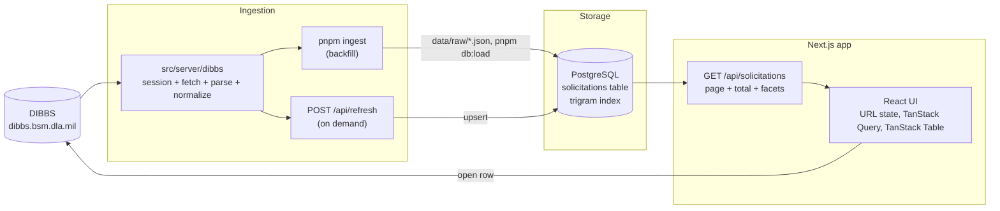

<!--
Draft written from docs/PRD.md before integration.
Before submitting: verify every feature claim against the merged app, resolve each TODO(integration) comment, and add a screenshot.
-->

# Solicitation Browser

A fast, focused way for defense suppliers to find the DIBBS RFQs worth quoting on.

The U.S. Defense Logistics Agency posts hundreds of Requests for Quotation to [DIBBS](https://www.dibbs.bsm.dla.mil/RFQ/) every weekday.
Solicitation Browser pulls them daily into its own database and turns them into a dense, searchable, filterable table that answers one question in under a minute:

> Which new RFQs are worth my time to quote today?

The original assignment brief is in [`docs/ASSIGNMENT.md`](docs/ASSIGNMENT.md).

<!-- TODO(integration): screenshot of the main view, e.g. docs/screenshot.png -->

## Quick start

Requires Node 24, pnpm, and Docker.

```bash
docker compose up -d        # Postgres 17 on localhost:5433
cp .env.example .env
pnpm install
pnpm db:migrate             # create the schema (idempotent)
pnpm ingest --days 5        # pull the last 5 days of RFQs from DIBBS into data/raw/
pnpm db:load                # load the sample fixture and data/raw/ into Postgres
pnpm dev                    # http://localhost:3000
```

Skip `pnpm ingest` to run fully offline: `pnpm db:load` always loads the committed sample in `data/fixtures/`, so the app never depends on DIBBS being up.

## The product

### Who it is for

A small or mid-size parts supplier.
They sell into a handful of product categories, may qualify for small-business set-asides, and need enough lead time to source and price a part before the quote is due.
They check DIBBS every morning and quote on a small fraction of what they see.

The job is not "browse RFQs".
It is triage: discard most of the list quickly and confidently, then act on the few that fit.
Every design decision below follows from that.

### What it does

- **Browse** recent RFQs in a dense, sortable table: solicitation number, NSN, item name, product class, quantity, set-aside, issue date, and due date with a days-left badge.
- **Search** with one box across solicitation number, NSN (with or without dashes, partial matches work), part number, and item name.
- **Filter** by what decides whether an RFQ is worth quoting (below), with live counts next to every option.
- **Open on DIBBS**: every row links back to its original solicitation page.
- **Stay current**: a "Synced 12 min ago" indicator and a Refresh button that pulls today's RFQs on demand.
- **Share a view**: every search, filter, sort, and page lives in the URL, so a filtered view can be bookmarked or sent to a colleague, and the back button works.

### Filter choices, and why

Each filter answers a question a vendor asks while triaging.

| Filter | The vendor's question | Why it matters |
| --- | --- | --- |
| Due date (3, 7, 14 days; expired hidden) | Can I still quote this in time? | An RFQ due tomorrow is worthless if sourcing takes a week. Expired RFQs are noise, so they are hidden by default. |
| Issued date (today, 3 days, 7 days) | What is new since I last looked? | Matches the daily habit: check what was posted since yesterday. |
| Product category (FSC, with names) | Is this something I sell? | Suppliers specialize. The first 4 digits of an NSN are its Federal Supply Class, so "Screws" or "Packing and Gasket Materials" becomes a one-click filter instead of memorized codes. |
| Set-aside | Am I even eligible? | Small-business, SDVOSB, HUBZone and similar set-asides decide whether a vendor can bid at all. |
| Buying office | Who is buying? | Vendors build relationships and track records with specific DLA centers (Aviation, Land and Maritime, Troop Support). Derived from the solicitation number prefix. |
| Quantity | Is it my size? | A proxy for deal size and fit with production or inventory capacity. |
| Technical documents | Can I actually make or source this? | Without drawings or specs, many suppliers cannot quote, so they want to skip those up front. |

Every multi-select option shows how many results it would add, and an option's count ignores that same filter's own selection, so picking "Screws" never hides "Bolts" from the list.

The defaults are opinions too: the table opens on open RFQs sorted by the soonest due date, because the most urgent quotable work belongs at the top.

<!-- TODO(integration): adjust this table to the filters that actually shipped, based on which fields WS1 could ingest. -->

### Small things that make it feel fast

- Results stay on screen while the next query loads, so the table never flashes empty.
- Search is debounced, and `/` focuses the search box from anywhere.
- NSNs are shown in their familiar `4-2-3-4` format with a copy button.
- Due dates turn amber within a week and red within three days.
- Skeleton rows match the real row height, so nothing jumps when data arrives.
- Empty results offer a one-click "Clear filters"; errors keep the last good results visible with a retry.
- On a phone, filters move into a slide-over sheet.

## Architecture



### Ingestion: `src/server/dibbs`

DIBBS is an ASP.NET WebForms site behind a DoD consent banner and a web application firewall.
The client accepts the consent banner once per run, keeps a cookie jar, echoes the page's hidden view-state fields on every postback, and re-establishes the session if a response bounces back to the consent page.
It sends an honest User-Agent at low concurrency with timeouts and retries.

Parsing is kept in pure functions (raw response in, records out), separate from the HTTP code, so a markup change on DIBBS breaks one small, isolated function.
Every record is normalized into one shared shape, `Solicitation` in `src/lib/solicitation.ts`: NSNs as 13 digits, dates as `YYYY-MM-DD`, uppercase solicitation numbers, numeric quantities.
A bad page is recorded as a partial error rather than losing the whole day.

<!-- TODO(integration): which source WS1 chose (bulk daily files, search-result pages, or detail pages), RFQs per day, and time per day. -->

### Storage: PostgreSQL

One `solicitations` table mirrors the `Solicitation` contract, keyed by a deterministic `id`, so re-ingesting a day is an idempotent upsert.
Two generated columns do the heavy lifting:

- `office`: the first 6 characters of the solicitation number, which identify the DLA buying activity.
- `haystack`: solicitation number, NSN, part number, and item name, lowercased, with a `pg_trgm` GIN index.

### API: one endpoint for the whole view

`GET /api/solicitations` takes the same query parameters as the page URL and returns, in one response, the page of rows, the total count, facet counts for product class, set-aside, and buying office, and the last sync time.
The row query and the three facet queries run in parallel.

### UI: the URL is the state

The search box and filters write to the URL; the table reads from it.
`src/lib/query.ts` is the single parser and serializer for both the page URL and the API URL, so the client and server can never disagree about what a filter means.
TanStack Query keys on the parsed query and keeps the previous results visible while the next ones load; TanStack Table runs in manual mode because the server sorts and paginates.

## Design decisions and tradeoffs

| Decision | Alternatives considered | Why | What it costs |
| --- | --- | --- | --- |
| Ingest into our own database | Proxy DIBBS live on every request | DIBBS is slow, sits behind a consent wall and a firewall, and has no API. Our own copy gives millisecond queries, facet counts, and a demo that works when DIBBS is down. | Data is only as fresh as the last ingest, so freshness is shown in the UI and Refresh is one click away. |
| Filter and search on the server | Ship every row to the browser and filter there | Scales past a few thousand rows, keeps payloads small, and lets the database compute facet counts. | A network round trip per change, hidden by debouncing and by keeping previous results on screen. |
| Substring search on a trigram index | Postgres full-text search (`tsvector`) | Vendors search by partial NSNs and part numbers like `5305-01-2`, which word-based full-text search cannot match. A trigram index makes `%term%` fast. | No stemming or relevance ranking, which matters little for short item names and codes. |
| PostgreSQL | SQLite | Trigram indexes, and any managed Postgres makes a hosted demo trivial. | Needs Docker locally; one `docker compose up -d`. |
| Plain SQL with postgres.js | An ORM (Drizzle, Prisma) | One table and a handful of queries; fewer moving parts. The dynamic `WHERE` uses parameterized fragments, never string concatenation. | Row mapping is written by hand. |
| URL as the single source of truth | Component state or a client store | Shareable views, working back button, survives reload, no state-sync bugs. | Parameters must be parsed tolerantly; invalid values are dropped, never thrown. |
| Plain HTTP ingestion | Headless browser for every run | Faster, cheaper, and deployable anywhere. A browser was used only to understand the site and verify deep links. | More sensitive to markup changes, which is why parsing is isolated in pure functions. |
| Derive buying office from the solicitation number | Scrape it from detail pages | Free, instant, and always available. | Office names come from a small reference table that needs occasional updates. |
| No automated tests in this version | Unit tests for parsers and the query layer | The whole project had a one-hour budget; every change was verified by running the app in a browser. | Parsers and the query contract are the first things I would cover next. |

## How it was built

The whole project had a one-hour budget, so the plan was designed around parallel work by multiple AI coding agents, with me as the lead.

1. **PRD first.** [`docs/PRD.md`](docs/PRD.md) set the goals, filters, architecture, and constraints before any code.
2. **Contracts before code.** The `Solicitation` data shape and the query and API shape were fixed up front, so every workstream could build against them at once.
3. **A walking skeleton.** The scaffold shipped a stub API that served a fixture file with the full query contract, so the table, filters, and database layers were built in parallel and never waited on each other.
4. **File ownership.** Each workstream owned specific paths, so parallel branches merged without conflicts.
5. **Six workstreams.** Scaffold, DIBBS ingestion, storage and API, results table, search and filters, and reference data, each with its own brief in [`docs/agent-prompts/`](docs/agent-prompts/).

## What I would build next

- **Saved searches and alerts.** Vendors do not really want to browse; they want to be told. Saved filter sets ("my FSCs, small-business, due in 7+ days") plus a daily email of new matches is the natural next step.
- **Scheduled ingestion** with a small history of runs and their health.
- **Richer fields** from detail pages and solicitation PDFs: acquisition method suitability codes, approved sources (CAGE and part number), first article testing, and delivery days.
- **Award history per NSN**, so a vendor can see what the item sold for last time before pricing a quote.
- **Tests** for the DIBBS parsers against saved pages, and for the query layer.
- **A hosted demo** on managed Postgres.

## Project structure

```text
src/
  app/                    Next.js routes: the page, /api/solicitations, /api/refresh
  components/
    results/              results table and sync status
    search/               search box
    filters/              filter panel
  lib/
    solicitation.ts       the shared data contract
    query.ts              query contract and URL parsing, shared by page and API
    api.ts                URL state and data-fetching hooks
    reference/            FSC, buying office, and set-aside labels
  server/
    dibbs/                DIBBS session, fetching, parsing, normalization
    db/                   schema, client, upsert, and queries
scripts/                  ingest and database CLIs
data/fixtures/            committed sample data for offline demos
docs/                     assignment brief, PRD, agent briefs, DIBBS data-source notes
```
